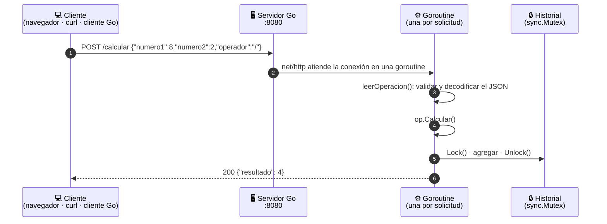

<div align="center">

# 🧮 Calculadora Distribuida en Go

**API REST que resuelve operaciones aritméticas a través de la red, con JSON, goroutines y exclusión mutua.**

[](https://github.com/OavegaETB/SistemasDistribuidos/actions/workflows/go.yml)


[Inicio rápido](#-inicio-rápido) ·
[Interfaz web](#-interfaz-web) ·
[API](#-api) ·
[Arquitectura](#-arquitectura) ·
[Pruebas](#-pruebas)

</div>

---

## 📌 Descripción

Aplicación distribuida cliente-servidor desarrollada para la actividad **"Desarrollo de una aplicación distribuida en lenguaje de programación"** del curso de Sistemas Distribuidos (criterio **CR4**).

El **servidor** publica el recurso `/calcular` en el puerto `8080`. Cualquier **cliente**, en el mismo equipo o en otro de la red, envía dos números y un operador en JSON y recibe el resultado.

| Requisito de la actividad | Dónde se cumple |
|---|---|
| Estructura `Operacion` con los campos de una operación | [`main.go`](main.go) → `type Operacion struct` |
| Método de la estructura | `func (o *Operacion) Calcular()` |
| Función que recibe las solicitudes HTTP | `func manejarCalcular(w, r)` |
| Puerto de la aplicación | `8080` (o variable de entorno `PUERTO`) |
| Servidor en escucha | `http.Server{...}.ListenAndServe()` con tiempos máximos |
| Prueba del aplicativo | [`main_test.go`](main_test.go) y [`scripts/`](scripts) |
| Código documentado y diagrama de flujo | Comentarios en español; diagramas de flujo entregados aparte |
| Manejo de errores en todos los escenarios | 14 casos controlados con código HTTP y mensaje claro ([ver tabla](#post-calcular)) |
| **Tema 4:** hilos y exclusión mutua | Goroutine por solicitud + historial con `sync.Mutex` |
| **CR4:** cliente local que consume un recurso remoto | [`cliente/main.go`](cliente/main.go) y la [interfaz web](web/index.html) |

## 🚀 Inicio rápido

**Requisito:** [Go 1.21 o superior](https://go.dev/dl/). No hay dependencias externas.

```bash
git clone https://github.com/OavegaETB/SistemasDistribuidos.git
cd SistemasDistribuidos
go run main.go
```

```text
Calculadora escuchando en http://localhost:8080
  GET  /           página web de la calculadora
  POST /calcular   {"numero1": 8, "numero2": 2, "operador": "/"}
  GET  /historial
```

Abra **<http://localhost:8080>** en el navegador para usar la [interfaz web](#-interfaz-web), o envíe una operación desde **otra terminal**:

<table>
<tr><th>🪟 Windows (PowerShell)</th><th>🐧 Linux / macOS / Git Bash</th></tr>
<tr><td>

```powershell
Invoke-RestMethod -Method Post `
  -Uri http://localhost:8080/calcular `
  -ContentType "application/json" `
  -Body '{"numero1": 15, "numero2": 7, "operador": "+"}'
```

</td><td>

```bash
curl -X POST http://localhost:8080/calcular \
  -H "Content-Type: application/json" \
  -d '{"numero1": 15, "numero2": 7, "operador": "+"}'
```

</td></tr>
</table>

```json
{"numero1":15,"numero2":7,"operador":"+","resultado":22}
```

O use el **cliente en Go**:

```bash
go run ./cliente 8 / 2                                   # 8 / 2 = 4
go run ./cliente 6 "*" 7                                 # 6 * 7 = 42
go run ./cliente -servidor http://192.168.1.20:8080 15 + 7   # servidor en otro equipo
```

> 💡 Para cambiar el puerto: `PUERTO=9090 go run main.go` (bash) o `$env:PUERTO=9090; go run main.go` (PowerShell).

## 🖥 Interfaz web

El mismo servidor entrega en `GET /` una página que funciona como **cliente gráfico** de la API. No hay que instalar nada más: el archivo [`web/index.html`](web/index.html) queda incluido dentro del ejecutable con `//go:embed`.

- Escriba dos números, elija la operación y pulse **Calcular en el servidor**. La página hace `fetch("/calcular")`; un paquete azul viaja del navegador al servidor y vuelve en ámbar con la respuesta. El resultado se muestra en grande junto con el tiempo que tardó el servidor.
- **Lo que viajó por la red** muestra el JSON de la solicitud y de la respuesta, con su código de estado (`200 OK` o `400 Bad Request`).
- El **historial del servidor** se actualiza solo cada 2 segundos y marca cada operación como *enviada desde esta página* o *enviada por otro cliente* (por ejemplo, `go run ./cliente 8 / 2`). Así se ve en vivo que varios clientes comparten el mismo recurso remoto.
- Tiene modo claro y oscuro automático, se adapta al celular, se puede usar solo con el teclado y respeta la opción del sistema de reducir el movimiento.

Cada animación tiene un propósito: explicar el viaje del mensaje, confirmar que se pulsó un botón o mostrar que algo cambió. Solo se animan `transform` y `opacity` (más un leve desenfoque en los cambios de contenido), con curvas `ease-out` fuertes y duraciones de 140 a 260 ms; el viaje del paquete dura 520 ms porque es explicativo. Con "reducir movimiento" activado, los desplazamientos se reemplazan por fundidos.

## 📡 API

### `POST /calcular`

| Campo | Tipo | Descripción |
|---|---|---|
| `numero1` | número | Primer operando |
| `numero2` | número | Segundo operando |
| `operador` | texto | `+`, `-`, `*` o `/` |

| Caso | Código | Respuesta |
|---|:---:|---|
| Operación correcta | `200` | `{"numero1":8,"numero2":2,"operador":"/","resultado":4}` |
| División entre cero | `400` | `{"error":"no se puede dividir entre cero"}` |
| Operador no válido | `400` | `{"error":"operador no válido, use +, -, * o /"}` |
| Resultado fuera de rango (`1e308 * 10`) | `400` | `{"error":"el resultado es demasiado grande para representarlo"}` |
| Falta un campo | `400` | `{"error":"faltan campos en el JSON: numero2"}` |
| Campo desconocido | `400` | `{"error":"JSON inválido: json: unknown field \"extra\""}` |
| JSON mal formado, tipo incorrecto o dos objetos seguidos | `400` | `{"error":"JSON inválido: ..."}` |
| Cuerpo de más de 1 KB | `400` | `{"error":"JSON inválido: http: request body too large"}` |
| Método distinto de POST | `405` | `{"error":"use el método POST"}` y encabezado `Allow: POST` |
| Ruta inexistente | `404` | `404 page not found` |

El servidor además corta las conexiones que se quedan abiertas sin enviar nada (`ReadHeaderTimeout`, `ReadTimeout`, `WriteTimeout`, `IdleTimeout`).

### `GET /`

Página web de la calculadora (HTML).

### `GET /historial`

Devuelve todas las operaciones realizadas, con su fecha. Se puede abrir directamente en el navegador: <http://localhost:8080/historial>.

## 🏗 Arquitectura



Varias solicitudes se procesan **al mismo tiempo**, cada una en su goroutine. El historial es el único recurso compartido y el `sync.Mutex` garantiza que solo una goroutine a la vez lo modifique (exclusión mutua). La prueba `TestHistorialConcurrente` lo comprueba con 100 goroutines y el detector de carreras de Go.

## ✅ Pruebas

```bash
go test -v -race ./...
```

| Prueba | Qué verifica |
|---|---|
| `TestCalcular` | Suma, resta, multiplicación, división, decimales, negativos, división entre cero, operador inválido y resultado fuera de rango |
| `TestManejarCalcular` | El endpoint HTTP responde 200, 400 y 405 según el caso |
| `TestHistorialConcurrente` | 100 goroutines escriben a la vez sin perder registros ni generar carreras |
| `TestManejarInicio` | La página web se entrega en `/` y las rutas inexistentes responden 404 |
| `TestValidacionDeEntrada` | 8 entradas inválidas (cuerpo vacío, campo faltante, tipo incorrecto, campo desconocido, datos sobrantes, cuerpo de 2 KB…) responden 400 con mensaje |

23 pruebas en total. En Windows, `-race` necesita gcc; sin él, use `go test -v ./...`.

Las pruebas se ejecutan automáticamente en GitHub Actions en cada `push`.

**Pruebas manuales listas para usar:**

| Archivo | Uso |
|---|---|
| [`scripts/pruebas.ps1`](scripts/pruebas.ps1) | `powershell -ExecutionPolicy Bypass -File scripts\pruebas.ps1` |
| [`scripts/pruebas.sh`](scripts/pruebas.sh) | `bash scripts/pruebas.sh` |
| [`scripts/solicitudes.http`](scripts/solicitudes.http) | Extensión *REST Client* de VS Code |

## 📁 Estructura

```text
SistemasDistribuidos/
├── main.go                 # Servidor: Operacion, Calcular, manejadores HTTP, mutex
├── main_test.go            # Pruebas automáticas
├── go.mod                  # Módulo de Go
├── cliente/
│   └── main.go             # Cliente de consola que consume /calcular
├── web/
│   └── index.html          # Interfaz web (incluida en el ejecutable con go:embed)
├── scripts/                # Pruebas manuales (PowerShell, bash, REST Client)
└── .github/workflows/go.yml  # Integración continua
```

## 🛠 Tecnologías

- **Go** (librería estándar): `net/http`, `encoding/json`, `sync`, `embed`, `testing`
- **HTML, CSS y JavaScript** sin librerías para la interfaz web
- **HTTP + JSON** como protocolo de comunicación (estilo REST)
- **GitHub Actions** para ejecutar las pruebas en cada cambio

## 📚 Referencias

- López Fuentes, F. A. (2015). *Sistemas distribuidos*. Universidad Autónoma Metropolitana.
- Tanenbaum, A. S., & Van Steen, M. (2007). *Distributed systems: Principles and paradigms* (2nd ed.). Pearson.
- Coulouris, G., Dollimore, J., Kindberg, T., & Blair, G. (2012). *Distributed systems: Concepts and design* (5th ed.). Addison-Wesley.
- The Go Authors. (s. f.). *Documentation*. <https://go.dev/doc/>

---

<div align="center">
<sub>Sistemas Distribuidos · Fundación Universitaria Compensar</sub>
</div>
